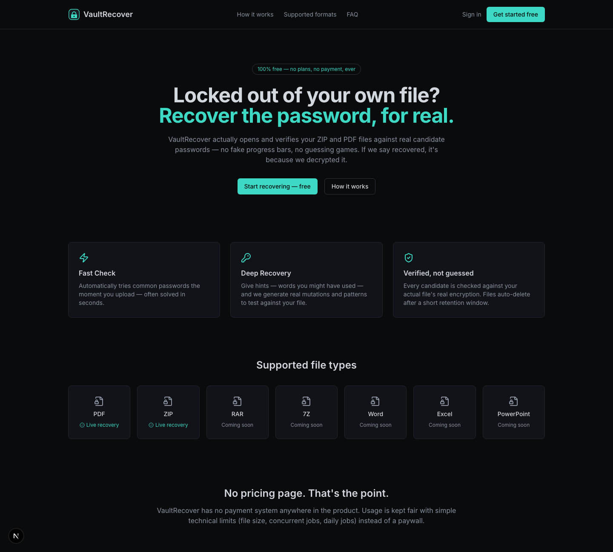
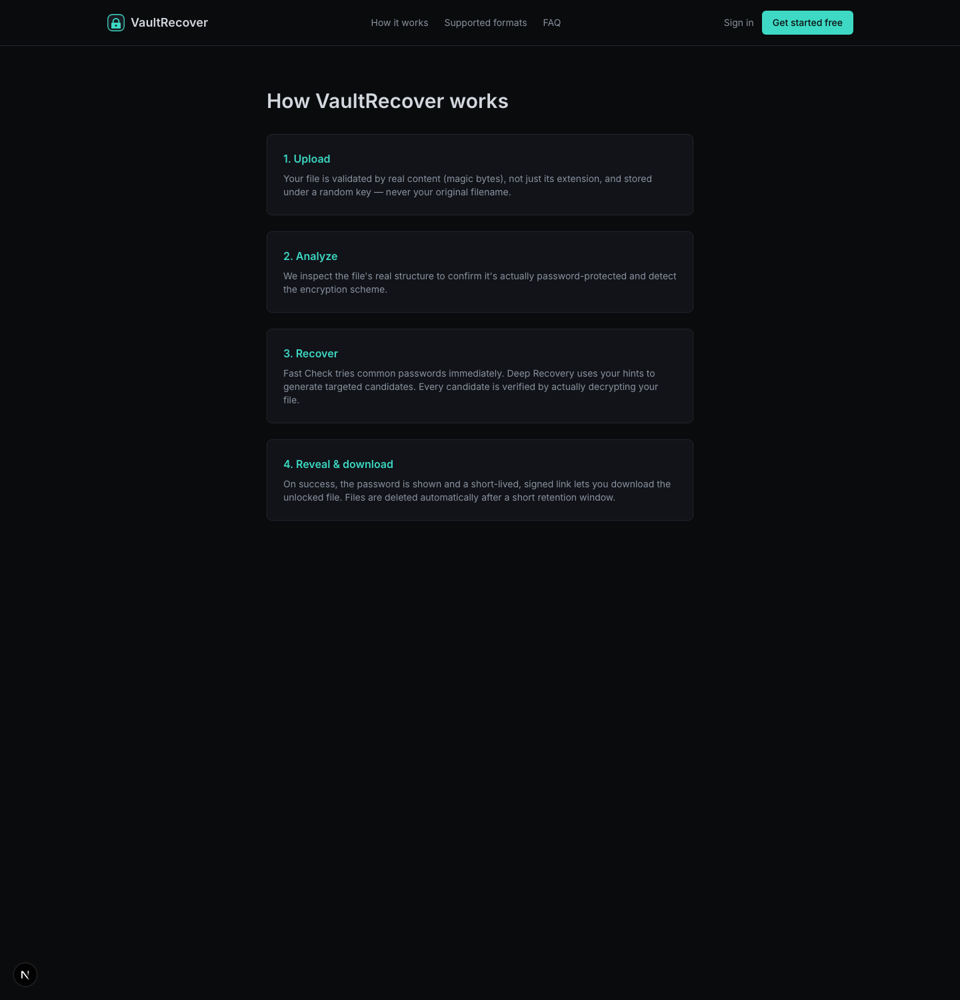

<div align="center">

# VaultRecover

**Free, honest password recovery for your own ZIP and PDF files.**

VaultRecover actually opens, verifies, and decrypts your files against candidate
passwords. It never fakes progress and never reports a success it hasn't verified
against the real file. There is no payment system anywhere in the product; fair use
is enforced with simple technical limits instead of a paywall.

[](https://github.com/KArT4206/VaultRecover/actions/workflows/ci.yml)
[](https://github.com/KArT4206/VaultRecover/actions/workflows/codeql.yml)


**Live app:** [vaultrecover-topaz.vercel.app](https://vaultrecover-topaz.vercel.app) · **Docs site:** [kart4206.github.io/VaultRecover](https://kart4206.github.io/VaultRecover/)

</div>

> **Intended use.** VaultRecover is for recovering passwords to files **you own or
> are authorised to access**. It verifies candidates you supply or that come from a
> small common-password list; it is not a mass-cracking tool.

## Two ways to run it

| | Hosted (this live site) | Local (full install) |
|---|---|---|
| **ZIP** (traditional / ZipCrypto) | ✅ Works in-browser, no install | ✅ via `unzip` |
| **PDF** | ▶️ Run locally | ✅ via `qpdf` |
| **Office (Word/Excel/PowerPoint)** | ▶️ Run locally | ✅ |
| **7-Zip** | ▶️ Run locally | ✅ |
| **RAR** | Informational page | Informational page |
| Background worker / Redis | not required | required |

The hosted deployment verifies traditional-PKWARE **ZIP** passwords entirely inside a
serverless function — no worker, no CLI binary (see
[`lib/analyzers/zipcrypto.ts`](lib/analyzers/zipcrypto.ts), parity-tested against the
`unzip` binary in [`tests/zipcrypto.test.ts`](tests/zipcrypto.test.ts)). Every other
format recovers in the local worker, which uses `qpdf`/`unzip`/7-Zip, and the hosted UI
says so honestly instead of pretending.

## Stack

- **Next.js 15** (App Router) + TypeScript + Tailwind
- **Prisma** + **PostgreSQL**
- **Redis** + **BullMQ** (job queue) + Server-Sent Events for live progress — local only
- Local-disk storage behind an S3-compatible `StorageProvider` interface
- **Auth.js (NextAuth v5)** — email/password credentials; Google OAuth wired but env-gated
- Real recovery engines: pure-TS ZipCrypto (hosted) and `qpdf` / `unzip` / 7-Zip CLIs (local)
- Zod validation, `pino` structured logging, an `AuditLog` table

## Quick start (local, full functionality)

```bash
npm install
cp .env.example .env          # set DATABASE_URL, AUTH_SECRET, DOWNLOAD_URL_SECRET
npx prisma migrate deploy     # create the schema
npm run seed                  # optional: demo@vaultrecover.test / DemoPassword123!

npm run dev                   # web app  -> http://localhost:3000
npm run worker                # second terminal: BullMQ worker (PDF/Office/7z)
npm run cleanup               # optional: scheduled expired-file cleanup
```

Prerequisites: Node 20+, PostgreSQL, Redis, and `qpdf` + `unzip`/`zip` on `PATH`
(`brew install qpdf` on macOS). Postgres/Redis can come from `docker compose up -d
postgres redis`.

## Deploy the hosted (ZIP-only) build to Vercel

The hosted build needs only Postgres (e.g. Neon) and three secrets. Set
`NEXT_PUBLIC_DEPLOY_TARGET=vercel` so the UI uses the in-process ZIP engine.

```bash
vercel link
vercel env add DATABASE_URL            # Neon connection string
vercel env add AUTH_SECRET             # openssl rand -base64 32
vercel env add DOWNLOAD_URL_SECRET     # openssl rand -base64 32
vercel env add NEXT_PUBLIC_DEPLOY_TARGET   # value: vercel
vercel --prod
```

Full walkthrough: [docs/DEPLOYMENT.md](docs/DEPLOYMENT.md).

## Screenshots

| Landing | How it works |
|---|---|
|  |  |

## Testing

```bash
npm run lint
npm run typecheck
npm run test     # vitest — real ZIP/PDF/Office/7z recovery + pure-TS ZipCrypto parity
npm run build
```

The suite includes end-to-end tests that create genuinely encrypted files and recover
them against the real binaries, and a test asserting the pure-TS ZipCrypto verifier
agrees with `unzip` with zero false positives over thousands of wrong candidates.

## Documentation

- [Architecture](docs/ARCHITECTURE.md) — components and data flow
- [Security](docs/SECURITY.md) — validation, limits, what's deferred
- [Deployment](docs/DEPLOYMENT.md) — Vercel + Neon, and the local worker
- [API](docs/API.md) — every route
- [Development](docs/DEVELOPMENT.md) — local setup and conventions
- [Limits](docs/LIMITS.md) — the fair-use limits (no paywall)
- [Roadmap](docs/ROADMAP.md) — what's deferred and planned
- [Contributing](CONTRIBUTING.md) · [Code of Conduct](CODE_OF_CONDUCT.md)

## License

[MIT](LICENSE).
